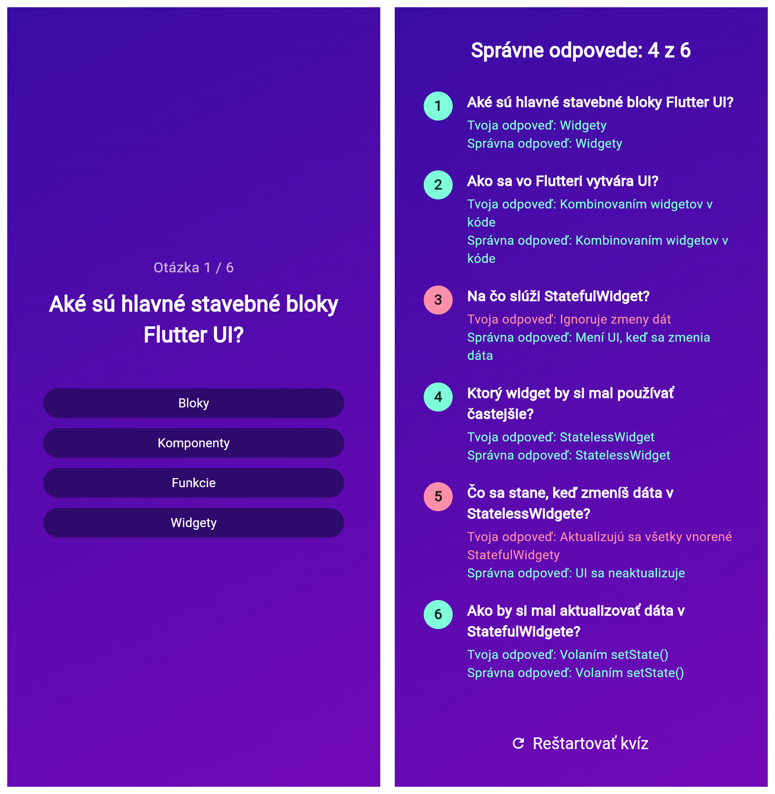

# Quiz App

Flutter kvíz s tromi obrazovkami: úvod → otázky → výsledky s možnosťou reštartu.

- `Quiz` (`StatefulWidget`) drží aktívnu obrazovku a zoznam zvolených odpovedí, prepína ich cez `setState()`,
- otázky sú v `lib/data/questions.dart` ako zoznam `QuizQuestion` (prvá odpoveď je vždy správna),
- odpovede sa zamiešajú (`shuffle`) a vykreslia cez `map()` + spread operátor `...`,
- po výbere odpovede sa automaticky zobrazí ďalšia otázka, po poslednej výsledky,
- výsledky sa mapujú na prehľad (`indexed.map`), počet správnych cez `where(...).length`,
- prehľad odpovedí je v `Expanded` + `SingleChildScrollView`, položky sú `Row` s `Expanded` stĺpcom.

## Štruktúra

```
lib/
├── data/
│   └── questions.dart
├── models/
│   ├── answer_button.dart
│   └── quiz_question.dart
├── main.dart
├── quiz.dart
├── start_screen.dart
├── questions_screen.dart
├── results_screen.dart
└── questions_summary.dart
```

## Spustenie

```
flutter pub get
flutter run
```

## Ukážka


